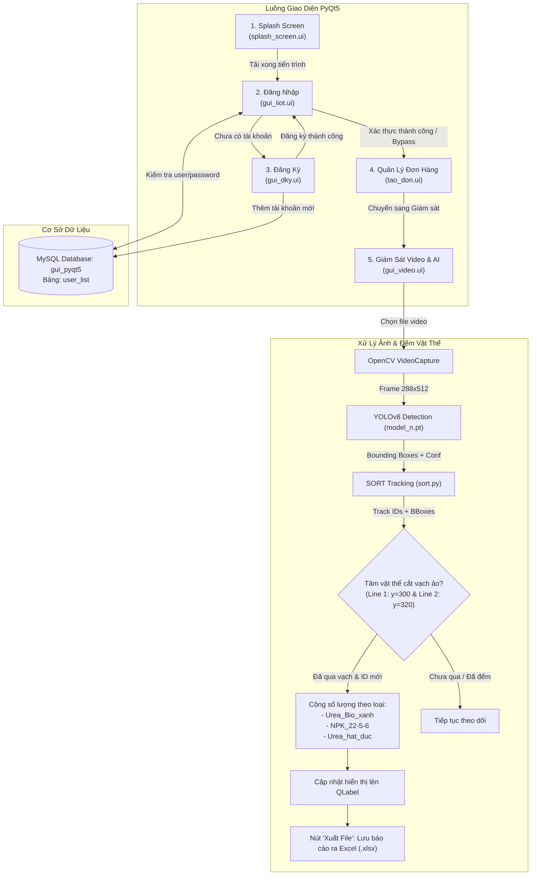

# TÀI LIỆU TỔNG QUAN HỆ THỐNG HIỆN TẠI (AS-IS ARCHITECTURE)
## Dự án: Nhận diện, Phân loại và Đếm bao Phân bón Cà Mau (Ca Mau Fertilizer Classification & Tracking)

---

## 1. Thông tin chung về dự án

| Thuộc tính | Chi tiết |
| :--- | :--- |
| **Tên dự án** | Ca-Mau-Fertilizer-Classification |
| **Bài toán thực tế** | Nhận diện, phân loại và đếm tự động bao phân bón trên băng chuyền kho vận nhằm hỗ trợ quản lý chuỗi cung ứng nông nghiệp |
| **Đơn vị / Bối cảnh** | Trường Đại học Kỹ thuật - Công nghệ Cần Thơ (CTUET) & Phân bón Cà Mau (PVCFC) |
| **Công nghệ cốt lõi** | Python, YOLOv8 (Ultralytics), SORT Tracking, PyQt5, MySQL, OpenCV |
| **Hiệu năng công bố** | Độ chính xác nhận diện phân loại đạt khoảng **92%** |
| **Đối tượng nhận diện** | 3 dòng phân bón chính: `Urea_Bio_xanh`, `NPK_22-5-6`, `Urea_hat_duc` |

---

## 2. Cấu trúc thư mục & Danh mục tệp tin

```text
Ca-Mau-Fertilizer-Classification/
├── README.md                          # Giới thiệu sơ lược dự án và đường dẫn tham khảo
├── assets/
│   ├── icons/
│   │   ├── logo.qrc, logoctuet.qrc    # File tài nguyên Qt Resource
│   │   ├── logo_rc.py, logoctuet_rc.py# Mã nguồn Python sinh ra từ file .qrc
│   │   └── logo_cm.qrc
│   └── images/
│       ├── dam_cm.png                 # Ảnh bao bì đạm Cà Mau
│       ├── icon_logo.png              # Icon ứng dụng
│       ├── logo_ctuet.png             # Logo trường ĐH KT-CN Cần Thơ
│       ├── phan_bon_cm.png            # Logo thương hiệu Phân bón Cà Mau
│       └── thumuc.png                 # Icon thư mục
├── docs/
│   ├── setup.txt                      # Danh sách các thư viện cần cài đặt
│   └── TONG_QUAN_DU_AN.md             # [Tài liệu này] Tổng hợp chi tiết hiện trạng hệ thống
├── models/
│   ├── model_n.pt                     # Trọng số mô hình YOLOv8n đã train (~6.23 MB)
│   └── file_model.pt                  # Trọng số checkpoint/dự phòng (~6.28 MB)
├── src/
│   ├── gui/                           # Giao diện người dùng (.ui thiết kế bằng Qt Designer)
│   │   ├── splash_screen.ui           # Màn hình chờ nạp dữ liệu (Splash screen)
│   │   ├── gui_iiot.ui                # Giao diện Đăng nhập hệ thống
│   │   ├── gui_dky.ui                 # Giao diện Đăng ký tài khoản
│   │   ├── tao_don.ui                 # Giao diện Tạo và Quản trị đơn hàng
│   │   └── gui_video.ui               # Giao diện Giám sát video & Đếm sản phẩm
│   ├── main/                          # Mã nguồn điều khiển chính
│   │   ├── Code_main.py               # Ứng dụng chính (tích hợp trọn vẹn 5 màn hình + CSDL + AI)
│   │   ├── start_time.py              # Phiên bản chạy nhanh (bỏ qua Splash và Đăng nhập)
│   │   ├── load_gui.py                # Script chạy thử nghiệm hiệu ứng Splash Screen
│   │   └── count_and_tracking_fertilizer.py # Script thử nghiệm độc lập thuật toán YOLO + SORT
│   └── utils/                         # Tiện ích bổ trợ
│       ├── class.txt                  # Danh mục 3 nhãn phân bón
│       └── sort.py                    # Thuật toán Simple Online and Realtime Tracking (SORT)
```

---

## 3. Kiến trúc hệ thống & Luồng hoạt động

Hệ thống hoạt động theo luồng ứng dụng máy tính đa màn hình kết hợp mô hình AI thời gian thực:



---

## 4. Chi tiết từng phân hệ chức năng

### 4.1. Phân hệ Giao diện & Nghiệp vụ (PyQt5)

| Màn hình | Tệp giao diện / Mã nguồn | Chức năng nghiệp vụ |
| :--- | :--- | :--- |
| **1. Splash Screen** | `splash_screen.ui`<br>`load_gui.py` / `Code_main.py` | Hiệu ứng tải ứng dụng không viền (Frameless), bóng đổ (Drop Shadow), thanh ProgressBar chạy từ 30% đến 100% kèm nhãn trạng thái ("Loading Database", "Loading UI"). |
| **2. Đăng nhập** | `gui_iiot.ui`<br>`Code_main.py (Login_w)` | Xác thực người dùng qua MySQL hoặc tài khoản khẩn cấp (hardcoded: `phanloaisp` / `123`). Hỗ trợ phím `Enter` để đăng nhập nhanh. |
| **3. Đăng ký** | `gui_dky.ui`<br>`Code_main.py (Reg_w)` | Nhập Username, Mật khẩu và Nhập lại mật khẩu; kiểm tra trùng lặp tài khoản và lưu vào bảng `user_list`. |
| **4. Tạo đơn hàng** | `tao_don.ui`<br>`Code_main.py (Main_w)` | Quản lý giỏ hàng theo tên khách hàng, loại phân bón và số lượng. Cho phép thêm, cập nhật số lượng, xóa đơn hàng, chỉnh sửa trực tiếp trên bảng `QTableWidget`. |
| **5. Giám sát & Đếm** | `gui_video.ui`<br>`Code_main.py (Video_g)` | Chọn video từ bộ nhớ (`QFileDialog`), chạy AI phát hiện, hiển thị khung hình theo thời gian thực kèm số lượng đếm được của 3 loại phân, đồng hồ hệ thống và nút xuất báo cáo ra Excel. |

---

### 4.2. Phân hệ Cơ sở dữ liệu (MySQL)
- **Tên cơ sở dữ liệu**: `gui_pyqt5`
- **Địa chỉ kết nối**: `localhost:3306`, user: `root`, password: trống (mặc định XAMPP/WampServer).
- **Cấu trúc bảng**: `user_list`
  - `username` (VARCHAR)
  - `password` (VARCHAR - lưu dạng văn bản thuần / plain-text)

---

### 4.3. Phân hệ AI & Thị giác máy tính

#### A. Danh mục phân loại (`class.txt`):
1. `Urea_Bio_xanh`: Phân bón sinh học hạt xanh.
2. `NPK_22-5-6`: Phân bón công thức NPK 22-5-6.
3. `Urea_hat_duc`: Đạm hạt đục Cà Mau.

#### B. Trọng số mô hình (`models/model_n.pt`):
- Kiến trúc nền tảng: **YOLOv8 Nano** của Ultralytics.
- Đầu vào: Khung hình video được resize về kích thước chuẩn $(288 \times 512)$ để tăng tốc độ xử lý FPS.
- Đầu ra: Danh sách bounding boxes $(x_1, y_1, x_2, y_2)$, độ tin cậy $conf \in [0, 100\%]$ và chỉ số lớp $class\_id \in \{0, 1, 2\}$.

#### C. Thuật toán theo dõi SORT (`src/utils/sort.py`):
- Sử dụng **Bộ lọc Kalman (Kalman Filter)** để mô hình hóa trạng thái chuyển động của từng bao phân (tâm $x, y$, diện tích $s$, tỉ lệ khung $r$).
- Sử dụng **Thuật toán Hungarian / LAP (Linear Assignment Problem)** để ghép cặp giữa các bounding box phát hiện ở frame hiện tại với các track đang tồn tại dựa trên chỉ số IoU (Intersection over Union).
- Tham số cài đặt: `max_age=20` (số frame tối đa giữ track khi vật thể tạm thời mất dấu).

#### D. Thuật toán đếm qua vạch ảo (Virtual Line Counting):
1. Thiết lập 2 vạch ngang trên khung hình:
   - $Line_1: y = 300$
   - $Line_2: y = 320$
2. Tính toạ độ tâm của bao phân bón:
   $$c_x = x_1 + \frac{x_2 - x_1}{2}, \quad c_y = y_1 + \frac{y_2 - y_1}{2}$$
3. Điều kiện đếm:
   - Nếu $Line_1[y] \le c_y \le Line_2[y]$
   - VÀ `id` của bao phân chưa nằm trong tập hợp `detected_objects`.
   - $\rightarrow$ Tăng số lượng tương ứng của loại phân đó lên 1 và thêm `id` vào `detected_objects`.

#### E. Xuất dữ liệu báo cáo:
- Đóng gói dữ liệu số lượng 3 loại phân bón cùng thông tin thời gian bắt đầu (`start_time_str`) vào cấu trúc `pandas.DataFrame`.
- Mở hộp thoại `QFileDialog` để người dùng chọn vị trí lưu file `.xlsx`.

---

## 5. Ngăn xếp công nghệ & Thư viện phụ thuộc

| Thành phần | Công nghệ / Thư viện | Phiên bản / Ghi chú |
| :--- | :--- | :--- |
| **Ngôn ngữ** | Python | Phiên bản khuyến nghị: 3.8 - 3.10 |
| **Giao diện Desktop** | `PyQt5`, `Qt Designer` | Xây dựng GUI dạng QStackedWidget |
| **Mô hình AI** | `ultralytics` (YOLOv8), `torch` | Phát hiện vật thể |
| **Xử lý ảnh & Video** | `opencv-python`, `cvzone` | Đọc luồng video, vẽ bounding box, vạch đếm |
| **Bộ theo dõi (Tracker)** | `filterpy`, `scikit-image`, `scipy` | Phục vụ thuật toán Kalman Filter và SORT |
| **Cơ sở dữ liệu** | `mysqlclient` (`MySQLdb`) | Kết nối CSDL MySQL cục bộ |
| **Xử lý bảng tính** | `pandas`, `openpyxl` | Xuất dữ liệu đếm ra file Excel |

---

## 6. Đánh giá hiện trạng kỹ thuật (As-Is Analysis)

### 6.1. Điểm mạnh đã làm được:
- **Đầy đủ chu trình sản phẩm (End-to-End):** Kết hợp trọn vẹn từ bài toán AI thực tế $\rightarrow$ Huấn luyện mô hình riêng $\rightarrow$ Giao diện ứng dụng người dùng $\rightarrow$ Lưu trữ tài khoản $\rightarrow$ Xuất báo cáo kế toán/kho vận.
- **Có cơ chế chống đếm trùng:** Ứng dụng SORT tracker và tập hợp ID `detected_objects` để đếm chính xác qua vạch, không bị cộng dồn số lượng qua từng frame.
- **Giao diện thân thiện:** Có màn hình chờ, bảng quản lý đơn hàng trực quan.

### 6.2. Các điểm hạn chế & Nợ kỹ thuật (Technical Debt) từ 2 năm trước:
1. **Đường dẫn tương đối bị phụ thuộc thư mục thực thi (Hardcoded Relative Paths):**
   - Các lệnh `uic.loadUiType("gui_iiot.ui")`, `YOLO("model_n.pt")`, `open('class.txt')` đều giả định terminal đang đứng ở thư mục chứa file đó. Nếu chạy từ thư mục gốc dự án sẽ sinh lỗi `FileNotFoundError`.
2. **Logic gán nhãn trong vòng lặp SORT:**
   - Thuật toán SORT chỉ trả về tọa độ `[x1, y1, x2, y2, id]` chứ không lưu `class_id`. Trong mã nguồn cũ, biến `objectdetect` được lấy từ vòng lặp detection cuối cùng trước đó. Nếu trong 1 khung hình có cả 2 loại phân bón cùng lúc, nhãn có thể bị gán nhầm.
3. **Chưa xử lý đa luồng (UI Thread Blocking):**
   - Vòng lặp `while self.cap.isOpened():` chạy ngay trên Main Thread của PyQt5. Khi xử lý video dài, giao diện dễ bị đơ nhẹ hoặc không phản hồi nút bấm dừng mượt mà.
4. **Bảo mật cơ sở dữ liệu:**
   - Mật khẩu lưu dạng plain-text; kết nối MySQL cần cấu hình máy chủ cục bộ (XAMPP/WAMP) nên chưa đạt tính năng "cài là chạy ngay" (Zero-Config).

---

## 7. Định hướng nâng cấp & Hiện đại hóa (To-Be Roadmap)

Khi cần phát triển tiếp hoặc nâng cấp để đưa vào Portfolio / Báo cáo, hệ thống có thể được tinh chỉnh theo 3 giai đoạn:

```text
[Giai đoạn 1: Chuẩn hóa & Ổn định]
  ├── Chuẩn hóa toàn bộ đường dẫn bằng pathlib.Path (chạy từ bất kỳ đâu)
  ├── Chuyển CSDL từ MySQL sang SQLite (Zero-config, chạy ngay không cần cài XAMPP)
  └── Mã hóa băm mật khẩu tài khoản (SHA-256 / bcrypt)

[Giai đoạn 2: Hiện đại hóa AI Pipeline]
  ├── Thay thế sort.py bằng ByteTrack tích hợp sẵn trong Ultralytics (model.track(..., persist=True))
  ├── Tự động gắn chặt class_name với track_id, giải quyết triệt để lỗi nhầm nhãn
  └── Bổ sung vector kiểm tra hướng di chuyển của bao phân bón

[Giai đoạn 3: Tối ưu kiến trúc & Giao diện]
  ├── Tách video AI sang QThread riêng (giao diện siêu mượt, không bao giờ bị Not Responding)
  ├── Nâng cấp giao diện Modern Dark Mode / QSS đẹp mắt
  └── Hỗ trợ nguồn video linh hoạt (File video, Webcam, RTSP Camera công nghiệp)
```
